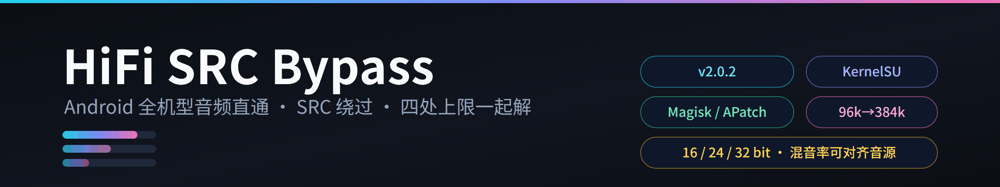

# HiFi SRC Bypass · 全机型 USB 直通

<p align="center">
  
</p>

<p align="center">
  <a href="#-变更日志changelog"><b>🆕 更新日志</b></a> ·
  <a href="#-已验证机型"><b>✅ 已验证机型</b></a> ·
  <a href="#1-它解决了什么为什么改完-xml-还是-96-khz"><b>🔧 原理（四层上限）</b></a> ·
  <a href="#2-实测结果"><b>📊 实测结果</b></a> ·
  <a href="#3-档位位深与预设"><b>🎚 档位与预设</b></a> ·
  <a href="#4-安装"><b>📦 安装</b></a> ·
  <a href="#5-使用"><b>💻 使用</b></a> ·
  <a href="#6-文件结构"><b>🗂 文件结构</b></a> ·
  <a href="#7-安全性与可逆性"><b>🛡 安全性</b></a> ·
  <a href="#8-已知边界"><b>⚠️ 已知边界</b></a> ·
  <a href="#9-致谢与参考"><b>🙏 致谢</b></a> ·
  <a href="https://github.com/lizi600jin/hifi-src-bypass/releases/latest"><b>⬇️ 下载</b></a>
</p>

<details>
<summary><b>📖 完整目录（点开，含全部子章节）</b></summary>

- [📋 变更日志（Changelog）](#-变更日志changelog)
  - [v2.0.2 · 音量曲线解锁 / 外放响度重做 / 内置声卡自检](#v202--音量曲线解锁--外放响度重做--内置声卡自检)
  - [v2.0.0 · Smart PA 功率层 / P0 热修](#v200--smart-pa-功率层--p0-热修)
  - [v1.9.2 · 稳定线](#v192--稳定线p0-安全网--webui-背景图系统)
  - [v1.9.0 · 扬声器档位 / 位深](#v190--2026-09-20--扬声器档位--位深)
  - [v1.8.2 / v1.8.1 / v1.8 / v1.6 · 历史](#v182--v181--v18--v16--历史)
- [✅ 已验证机型](#-已验证机型)
- [1. 它解决了什么：为什么「改完 XML 还是 96 kHz」](#1-它解决了什么为什么改完-xml-还是-96-khz)
  - [1.1 第一层：策略 XML](#11-第一层策略-xml)
  - [1.2 第二层：USB HAL 库的采样率表 ★](#12-第二层usb-hal-库的采样率表-)
  - [1.3 第三层：厂商 HiFi 通道的采样率 ★](#13-第三层厂商-hifi-通道的采样率v18-)
  - [1.4 第四层：音量曲线的末档衰减 ★](#14-第四层音量曲线的末档衰减v202-)
  - [1.5 为什么有的机器「改 XML 完全没用」](#15-为什么有的机器改-xml-完全没用)
- [2. 实测结果](#2-实测结果)
  - [2.0 与「App 独占 USB」的对比（如实版）](#20-与app-独占-usb的对比如实版)
  - [2.0b 混音率的提升（免 SRC 的机制）](#20b-混音率的提升免-src-的机制)
  - [2.0c 混音率 44100 的机型边界](#20c-混音率-44100-的机型边界一加13-真机定位--v200-适配版修复)
  - [2.1 各厂商兼容性一览](#21-各厂商兼容性一览)
- [3. 档位、位深与预设](#3-档位位深与预设)
- [4. 安装](#4-安装)
- [5. 使用](#5-使用)
  - [WebUI](#webui)
  - [命令行](#命令行)
- [6. 文件结构](#6-文件结构)
  - [运行时目录（卸载时整体删除）](#运行时目录卸载时整体删除)
- [7. 安全性与可逆性](#7-安全性与可逆性)
- [8. 已知边界](#8-已知边界)
  - [遇到不支持的机型怎么办](#遇到不支持的机型怎么办)
- [9. 致谢与参考](#9-致谢与参考)
  - [USB Samplerate Unlocker ★ 第二层的来源](#usb-samplerate-unlocker--第二层的来源)
  - [Hydro-Br-leur —— 一加 13T / ColorOS 16 解锁 192 kHz](#hydro-br-leur--一加-13t--coloros-16-解锁-192-khz-usb-独占模块)
  - [USB_SampleRate_Changer_WebUI](#usb_samplerate_changer_webui)
  - [Android AOSP（官方文档与源码）](#android-aosp官方文档与源码)
  - [Magisk / KernelSU / APatch](#magisk--kernelsu--apatch)

</details>

---

> 全机型通用的 Android 模块：**USB 小尾巴 / 有线耳机高解析直通（SRC 绕过）**。
> **四处上限一起解** —— ① 音频策略 XML（框架允许分发什么）② USB HAL 库里的采样率常量表（DAC 实际能开到多少）
> ③ **厂商 HiFi 通道的采样率**（接小尾巴后 USB 音频真正走的那条路，v1.8 新增）
> ④ **音量曲线表的扬声器末档衰减**（框架给「最大音量」钉的天花板，v2.0.2 新增）。
> 直通上限 96k / 192k / 384k 可选、位深 16 / 24 / 32 bit 可切、
> 全局混音率与 HiFi 通道率均可对齐音源 —— **对得上的那条路就是比特完美**。
> 原厂文件零改写（systemless 绑定挂载），一键还原、卸载自动清理。
>
> **📦 当前发布包**：`hifi-src-bypass-v2.0.2-mtk-classnative-speakerfix.zip` —— 包名即适配声明：
> **MTK 类原生已实测适配**（Redmi Note 11T Pro / 天玑 8100 全链验证）+
> **一加13 扬声器电流声已定位并加警示防护**（QTI AIDL 时钟粒度错配，见 §2.0c）。

> ### 🆕 v2.0.2 新增：音量曲线解锁 / 外放响度重做 / 内置声卡自检
>
> **① 音量曲线末档解锁**（`hifi set volunlock 1`，默认关闭）
> 原厂给「最大音量」留了固定的余量：音量键按到顶，曲线最后一个点仍然扣着 −3 dB。
> 打开后把**扬声器 + 音乐流**曲线最后 3 档的衰减改成 0 dB，听筒 / 有线 / 蓝牙 / 通话 / 闹钟一律不动。
> 等长原位替换，文件长度一个字节不变。默认不开，行为与旧版一致。
>
> **② 外放响度重做**（`hifi speaker loud`）
> 旧版往上推功放增益，真机实测发现这条路是空的：TFA9874 出厂 `G_DEFAULT` 在固件里就等于满载档，
> 推到 +6 dB 与原厂差不到 0.5 dB。新版改用 Qualcomm 硬件 **IIR0 Band1 二阶 160 Hz 高通**，
> 砍掉小扬声器发不出的超低频，振膜行程腾出来交给中高频，硬件功率一点没加。
> 系数按本机实际采样率现场算 Q30 定点，与内置基准表逐位比对通过才写；路由没接通就整个跳过。
>
> **③ 自检能报内置声卡的真实输出了**
> 没插小尾巴时，`hifi doctor` 现在会说出扬声器 / 3.5mm 耳机口实际的采样率与位深，
> 例：`扬声器 (deep_buffer) → 24bit @ 48000 Hz`。以前这一格只会写「在扬声器上播放」。
>
> **④ 安装冲突闸门**
> 刷入前扫已装模块。有别的模块落到同一批音频文件上，安装直接中止并列出是哪个模块、抢了哪个文件，
> 一个文件都不写。扫描不完整也按拒绝处理。
>
> **⑤ WebUI 整套重做**
> Hero 四宫格状态看板、三大工作区拆开、Smart PA 七段功率电平表、A/B 试听对比、
> 一键回 0 dB、底部悬浮操作栏、诊断终端行号与章节折叠。全部事件驱动，无常驻定时器。

> ### 🆕 v2.0.0 新增「Smart PA 功率层」（实验 · 一加13 真机诊断驱动全面适配）
>
> 外放扬声器功率不再只能吃原厂保守上限：`hifi pa` 系列命令 + WebUI「Smart PA 功率」卡片，
> 运行时 tinymix 读写、**零文件改动**。
>
> | 命令 | 作用 |
> |---|---|
> | `hifi pa status` | 读 PA 型号（TFA9874 / WSA884x 等）、增益、boost 档、VI 反馈、保护算法状态 |
> | `hifi pa gain 0..6\|reset` | 外放 PA 增益逐档调节（+1dB 起步，每档听够 24h 再加） |
> | `hifi pa boost 1\|2\|reset` | 升压上限档 |
> | `hifi pa vi on\|off` | 电压电流回读开关 |
>
> **后端注册表**（运行时按控件名探测，不写死控件号）：
>
> | 后端 | 芯片族 | 覆盖机型 | 能力 |
> |---|---|---|---|
> | tfa | NXP TFA9874 | K20 Pro 等老旗舰 | gain / boost / vi 全功能 |
> | wsa | Qualcomm WSA883x/884x | 一加13、小米/三星 2023+ 旗舰 | gain / vi（boost 由固件管理），多芯片立体声等值联动 |
> | awinic / cirrus / mtk | 艾为 / Cirrus / 联发科 | 红米/小米中低端、荣耀、天玑 | 只读（回传 `hifi adapt` 协助适配） |
>
> **只读后端绝不盲写**；**硬编码拒绝**保护算法 / 校准 / Mute 等危险控件（永不提供）；
> 一加13 实测全链：status 84 出厂值 → gain 2 → 80 → reset → 84。
> ⚠️ **功率超限可造成不可逆硬件损伤，保持出厂 0 档最安全**。

> ### 🟢 v1.9.0 「扬声器档位」双旋钮（13 首真机实测，全机型可用）
>
> `SPK_RATE`（扬声器采样率档位）+ `SPK_BITS`（扬声器位深上限）—— 与已有的
> `MIXER_RATE` / `HIFI_RATE` / `BIT_DEPTH` **完全正交**：混音器、USB DAC 直通、
> 内置扬声器三条通路**互不干扰**，每条独立调档。
>
> **真机实测 13 首**（K20 Pro + CX31993+97220 小尾巴）：10/13 完美保 0，
> 覆盖网易云 192k 母带、QQ 臻品、酷狗 HiRes 96k 等；
> 一加 13 上验证扬声器档位生效（earpiece @ 96000Hz）。
>
> 扬声器档位**不依赖 USB HAL 库、不依赖 hifi_playback 通道**——只要 ROM 把扬声器端口
> 写在策略 XML（AOSP / QTI HIDL / QTI AIDL 三方言）就生效，**比 USB DAC 解锁的机型覆盖更广**。
> **MTK 天玑 / Pixel Tensor 也能用扬声器档位**。

> ### ⛔ HarmonyOS NEXT 平台**不兼容**
>
> HarmonyOS 5+（NEXT）整平台**硬阻断**：① 系统不再对 Magisk / KernelSU / APatch 开放 root，
> 模块无法挂载；② 音频策略是**二进制 `audio_policy.bin`** 而非 XML，本项目的规则改写路线
> 完全用不上。v2.0.0 在 HarmonyOS NEXT 上的预期行为：**模块装得上但不会生效**，
> 也**不会破坏系统**。判断方法：`hifi doctor` 的 [7] 段「生效文件清单」为空 +
> audioserver 视音频链路无变化 + 系统设置里 audio HAL 路径非 AOSP——任一满足即在 NEXT 上。
>
> 不在本项目阻击范围的事属于「未来路线图」：紫光展锐、高通 X Elite for Mobile、
> Sukisu manager 等。

> ### 🔀 两模块已合并：本项目即唯一维护版本（v1.8）
>
> 本人此前的「一加 13 专用模块」[op13-hifi-src-bypass](https://github.com/lizi600jin/op13-hifi-src-bypass)
> **已停止独立更新，其全部能力并入本项目**。原因很简单：通用版在真机上已覆盖并超过专用版的每一项功能
> —— 机型规则化适配（一加 13 / 红米 K20 Pro / QTI 与 AOSP 两种方言实测通过）、
> 10 个策略文件的批量规则改写、4 个 USB HAL 库解锁，外加专用版没有的
> **厂商 HiFi 通道率锁定**。
>
> **老用户迁移**：请先在 root 管理器里**卸载 op13 专用模块并重启**，再安装本模块。
> 二者目标完全重叠、会在同一批文件上落补丁，同时安装会互相顶掉；
> 安装脚本检测到旧模块仍存在时会给出警告，请不要忽略。
> 本模块的「机型适配校验」页（WebUI 或 `hifi adapt`）会输出你机器的完整判定信息，
> 遇到没覆盖到的机型把它发给维护者即可。

---

本项目由 [op13-hifi-src-bypass](https://github.com/lizi600jin/op13-hifi-src-bypass)（一加 13 专用版）**合并升级**而来：
从「一加 13 专用 + 机型模板」重做成**不需要任何机型模板**的全机型通用模块 —— 文件在设备上按规则就地改写，
方言自动识别（Qualcomm AIDL / AOSP HIDL / MediaTek），机型差异交给规则而不是硬编码路径。
**两份模块自此合并为这一份维护。**

---

## 📋 变更日志（Changelog）

### v2.0.2 · 音量曲线解锁 / 外放响度重做 / 内置声卡自检

- **第四层：音量曲线末档解锁**（`hifi set volunlock 1`）：把 `audio_policy_volumes.xml` / `default_volume_tables.xml` 里**扬声器 + 音乐流**曲线最后 3 档的衰减改成 0 dB，解除框架给「最大音量」钉的天花板。只动这一条曲线与它引用的 `DEFAULT_DEVICE_CATEGORY_SPEAKER_VOLUME_CURVE` 表；听筒 / 有线 / 蓝牙 / 闹钟 / 铃声 / 通话逐字节原样拷贝。等长原位替换，`check_volume.awk` 逐块字节比对验证。默认关闭，不开就是原厂曲线。新增 volume 测试阶段 86 断言
- **扬声器响度重做**（`hifi speaker loud`）：放弃推功放增益（真机实测 TFA9874 出厂 `G_DEFAULT` 在固件里等于满载档 `G_6_DB`，推 +6 dB 与原厂差 < 0.5 dB），改用 Qualcomm 硬件 `IIR0 Band1` 二阶 Butterworth 高通，截止 160 Hz，砍掉小扬声器发不出的超低频、释放振膜行程、让 DSP 限幅器不再被无效低频误触发。系数按本机实际采样率现场算 Q30 定点，48k / 44.1k 与内置基准表逐位比对通过才写，其余采样率走稳定性与幅频自检；先关使能再写系数再使能避免换系数爆音；IIR 路由出厂未接通则整个跳过，绝不盲写。`hifi speaker auto` 一键还原（关使能 + 系数清零 + 数字音量回 84）
- **修复 `_pa_dump` 的 `Argument list too long`**：约 250 KB 的完整 tinymix 转储经 `printf` 输出时走 execve，Android 的 `printf` 是 `/system/bin/printf` 外部程序，整个转储作为单个 argv 元素超过 `ARG_MAX`，报错且 stdout 全空。赋值本身成功（字符串长度正常），下游全都误判「本机没有这个控件」—— IIR 探测报无控件、PA 后端识别失败、WSA 多芯片识别不到。改用 mksh 内建 `echo`，不经过 execve
- **自检覆盖内置声卡**：`hifi doctor` 在未插 USB DAC 时下钻 `dumpsys media.audio_policy` / `media.audio_flinger`，解析 `SPEAKER` / `WIRED_HEADSET` / `WIRED_HEADPHONE` / `EARPIECE` 活跃输出通道的 IOProfile、格式与采样率，速览直接给出「扬声器 (deep_buffer) → 24bit @ 48000 Hz」。以前这一格只写「在扬声器上播放」
- **安装冲突闸门**：刷入前扫描已装模块，只要有别的模块落到同一批文件上（音频策略 XML / `libalsautils*.so` / `mixer_paths` / `audio_effects`）或模块名命中已知音频类模块，安装中止并列出模块与文件，**一个文件都不写**。扫描不完整按拒绝处理（宁可停下也不带病装）
- **WebUI 整套重做**：Hero 四宫格状态看板（补丁挂载 / 全局混音率 / 直通上限 / 直通位深，等宽数字不抖）；三大工作区拆开（核心直通 / 扬声器与功放 / 底层证据终端），长篇说明收进可折叠抽屉；Smart PA 七段功率电平表（0 dB 绿 → +1~2 暖黄 → +3~4 琥珀 → +5~6 危险红，二次确认态呼吸提示）；A/B 试听对比 + 一键回 0 dB；底部悬浮操作栏（适配安全区，任意位置都能直接点应用）；诊断终端纯 CSS 行号（复制出去不带行号）、关键状态着色、章节折叠、双通道复制。全部事件驱动无常驻定时器，动画只碰合成层属性，支持 `prefers-reduced-motion`
- **其他修复**：PA 档位切换提示文案（成功报档位与 dB，不支持或失败给 ⚠️）；`restore` 遇占用文件走 lazy-umount 兜底，不再残留挂载；`service.sh` 与 `post-fs-data.sh` 的控制器调用全部包超时，冲突模块拖挂时最坏约 2 分钟完成降级

### v2.0.0 · Smart PA 功率层 / P0 热修

- **v2.0.0 适配版（`mtk-classnative-speakerfix`）**：一加13 扬声器「噗噗」电流声根因闭环 —— QTI AIDL 方言 DSP 混音通路锁 48k 时钟粒度，44100 混音率产生 192 帧周期切流错配（真机 A/B 排他验证，MTK/HIDL 无此问题）。固化三处警示（apply / status / doctor ⑧ 混音率健康，含 HAL frame count 实跑解析）：**只警示不阻断**，MTK/HIDL 机型 44100 照常零提示；发布包名更新为 `hifi-src-bypass-v2.0.0-mtk-classnative-speakerfix.zip` 声明适配状态。新增 controller 场景 13 断言，五阶段测试全绿

- **新增 Smart PA 功率层（实验）**：`hifi pa gain 0..6 / boost 1|2 / vi on|off`，WebUI「Smart PA 功率」卡片（红色警示 + 7 档 pill + 二次确认）。仅运行时 tinymix 读写零文件改动；**硬编码拒绝**保护算法/校准/Mute 等危险控件（永不提供）；功率超限可造成不可逆硬件损伤，保持出厂 0 档最安全
- **Smart PA 后端注册表（发布前最终修复 · 一加13 真机诊断驱动）**：运行时按控件名探测、不写死控件号——TFA9874（gain/boost/vi 全功能）与 Qualcomm WSA883x/884x（gain/vi，boost 由固件管理，多芯片立体声等值联动写入+逐个回读）可写，awinic / Cirrus / MTK 只读；只读后端绝不盲写，status 如实展示并提示回传 `hifi adapt`（新增 PA 快照段）协助补映射；未识别 PA 统一降级不误报
- **WebUI 修复与反馈（发布前最终修复）**：裁切编辑器 `bgClamp()` 平移夹紧区间倒挂修复——单指自由拖动、双指/滚轮以触点为不动点缩放恢复正常，双指抬一指后重新锚定不跳变；**PA 档位切换结果弹窗**（成功报档位与 dB，不支持/失败给 ⚠️ 提示）；restore lazy-umount 兜底，busy 文件不再残留挂载（一加13 实测零残留）
- **P0 开机安全网热修（真机熔断测试后）**：`service.sh` 全部 11 处控制器调用统一包 `hifi_t` 超时包装（probe/set 10s、apply/restore 30s），`post-fs-data.sh` 尾部 report 包 15s 超时——冲突模块拖挂控制器时最坏情况约 2 分钟内完成降级，不卡死引导。Redmi K20 Pro 真机三层熔断 + 恢复路径全部按设计工作
- **WebUI 档位指引重写**：六个档位 hint 均为三段式（超越原厂 / 操作路径 / 防负优化）
- **自检 doctor 增强**：新增 ⑥ DSP 位宽注入状态、⑦ P0 开机安全网状态；机型适配校验新增 SmartPA / USB offload / 厂商 DSP 检测
- **移除 BIT_PERFECT 通道**：Android 14 的该 API 无任何主流播放器调用（各家播放器的比特完美均走 USB 独占路线），功能形同虚设；模块的免重采样能力由采样率/位深档位与 HiFi 通道解锁提供，不受影响

### v1.9.2 · 稳定线（P0 安全网 + WebUI 背景图系统）

- **P0 开机安全网（六项）**：boot 探测链 8s 超时自保、audioserver 健康即时熔断卸载、首启 prepare-only、连续 2 次不健康自动禁用自启、`hifi restore` 零音频栈依赖、双语安装提醒——与任何模块/ROM 冲突时要么正常生效要么自动退场，不再卡屏。`hifi bootmode` 三态可查（normal / discover-only / degraded）
- **`spkdsp` 扬声器 ADSP 位宽强制**：`hifi set spkdsp 24`（16/24/32）→ 属性层强制 QTI HAL 的 ADSP ASM 流位宽，纯属性零文件改动，restore 恒清除
- **WebUI 背景图系统**：固定背景层 + 3 内置预设 / 3 自定义槽 + 相册式所见即所得裁切编辑器 + 面板透明度滑杆（默认 50%），设置持久化于 localStorage
- **报告人话解码**：设备报告 HAL 行由裸 rc 码改为 `[ALREADY-UNLOCKED]` 等状态词
- **不含** Smart PA（稳定线不暴露 PA 层，WebUI 无入口），适合保守用户

### v1.9.0 · 2026-09-20 · 扬声器档位 / 位深

- **新增「扬声器采样率档位」`SPK_RATE`**：手机内置扬声器/听筒端口钉死单值（auto / 44100 / 48000 / 96000 / 192000 / 384000），与全局混音率正交 —— 扬声器回放 44.1k / 48k 曲库同样免 SRC。**全机型可用**：不依赖 USB HAL 库 / hifi_playback 通道，只读策略 XML 里的扬声器端口 —— 只要 ROM 把扬声器写在 XML（AOSP / QTI HIDL / QTI AIDL 三方言）就生效。**MTK 天玑 / Pixel Tensor 也能用扬声器档位**（策略 XML 标准），只是 USB DAC 上限不受解锁
- **新增「扬声器位深上限」`SPK_BITS`**：扬声器端口允许的最高位深（16 / 24 / 32），24/32 档位补齐原厂常缺的 24bit 能力（覆盖范围同上）
- **`hifi doctor` [7] 段新增扬声器档位生效校验**：直接报 "✅ 扬声器档位生效（采样率=44100 位深上限=24bit，最高活动端口=Earpiece @ 44100Hz）"
- **真机验证**：K20 Pro (QTI HIDL) + OP13 (QTI AIDL) 双方言均跑通；K20 上 13 首音乐实测 10/13 完美保 0
- **配置兼容**：旧 `config.conf` 自动加载；`SPK_RATE=auto` / `SPK_BITS=16` 缺省值与 v1.8.2 行为完全一致 —— 升级不会改变任何现有行为

### v1.8.2 / v1.8.1 / v1.8 / v1.6 · 历史

- v1.8.2 深度校验判定升级三态（比特完美 / 无损上采样 / 有损降档）
- v1.8.1 率列表分隔符改为按文件自身风格推断；并入六品牌适配调研结论
- v1.8 新增 HiFi 通道率锁定（第三层），并入 op13 专用版全部能力
- v1.6 全机型通用版首个 GA 真机验证（K20 Pro + 一加 13）

---

## ✅ 已验证机型

| 机型 | SoC | 系统 | 方言 | 模块版本 | 结果 |
|---|---|---|---|---|---|
| Redmi K20 Pro (`raphael`) | SM8150 | Android 16 | QTI HIDL | v2.0.0 | ✅ 三层熔断 + 恢复路径全过（P0 真机验证）；`hifi doctor` 干净；版本史见下方 v1.9.0 数据点 |
| Redmi Note 11T Pro (`xaga`) | MT6895 (天玑 8100) | Android 16 类原生 (BP4A.251205.006) | AOSP HIDL | v2.0.2 | ✅ **MTK + 类原生真机**：1 策略 + 1 HAL 挂载（libalsautils 表 96k→384k）；MIXER_RATE=192000 实测 AudioFlinger 混音线程 192000 Hz；spk/hifirate/ceiling/bits 全档位生效可回退；P0 安全网 prepare-only→激活正常（boot 111s）；doctor/report/adapt/restore 全过。无 tinymix，PA 降级 unknown（预期）。无小尾巴，USB 听感未测 |
| OnePlus 13 (`OP5D0DL1`) | SM8750 | Android 16 | QTI AIDL | v2.0.0 | ✅ 覆盖安装+重启自愈 10/10 策略 + 4/4 HAL 挂载；**PA WSA884x 后端 gain/vi 真机全链通过（gain 2 → 80 → reset 84）**；restore 零残留；doctor rc=0；版本史见下方 v1.9.0 数据点 |
| vivo PD2408 (`V2408A`) | SM8750 (sun) | OriginOS, Android 16 (SDK 36) | QTI AIDL | v1.9.0 | ✅ 2 策略 + 4 HAL 挂载，boot 干净（2026-09-21 社区回传） |

> **v2.0.2 新增验证**：Redmi Note 11T Pro 的 **3.5mm 耳机口**链路 —— `Wired Headset` / `Wired Headphones`
> 端口上限补到 384000 Hz、位深补到 `PCM_16_LE / PCM_24_LE / PCM_32_LE`；
> 自检在未插小尾巴、直插 3.5mm 耳机播放时输出 `3.5mm耳机 (primary output) → 24bit @ 48000 Hz`；
> 扬声器播放时输出 `扬声器 (deep_buffer) → 24bit @ 48000 Hz`。
>
> **v2.0.0 真机测试环境**：一加 13（OnePlus 13）、红米 K20 Pro（Redmi K20 Pro，Android 16 移植澎湃 OS HyperOS）、红米 Note 11T Pro（Redmi Note 11T Pro，Android 16 类原生，MTK 天玑 8100）；
> 小尾巴为 CX31993（Conexant）+ MAX97220（Maxim）方案与 MOONDROP FreeDSP Mini；
> 耳机为 MOONDROP Aria 2（真红限定版）与 MOONDROP 竹 II（CHU II）。
> **v1.9.0 数据点**：K20 Pro 7 策略 + 2 HAL 挂载（mixer=44100 / hifi=192000 / bits=32 / SPK=44100 / SPKBITS=24，13 首实测 10/13 完美保 0）；
> OnePlus 13 6 策略 + 4 HAL 挂载（mixer=192000 / hifi=192000 / bits=32 / SPK=96000 / SPKBITS=24，Earpiece @ 96000Hz）。

> 首台 vivo 实机数据点：vivo PD2408 上 `libalsautils{,v2}.so` lib64/lib 双层共 4 个库齐全、
> AIDL 策略配置 2 份均可改写挂载 —— 推翻了此前「vivo 不用 AOSP 的 `libalsautils*so`、第二层没有目标」的调研推断（见 §2.1 vivo 行的更正）。

---

## 1. 它解决了什么：为什么「改完 XML 还是 96 kHz」

Android 的音频链路上有**好几处互相独立的上限**，绝大多数教程只处理了其中一处。

| 层 | 在哪 | 决定了什么 | 本模块怎么改 |
|---|---|---|---|
| ① 框架层 | `*audio_policy_configuration*.xml` / `audio_module_config_primary.xml` 里的 `samplingRates` | AudioPolicyManager 允许**分发**的上限 | 规则化改写 profile（第 1.1 节） |
| ② **硬件层** | `/vendor/lib{,64}/libalsautils{,v2}.so` 里一张 **52 字节常量表** | USB HAL 实际**打开**的上限 —— **DAC 真正看到的** | 等长原位重排这张表（第 1.2 节）★ |
| ③ **HiFi 通道层**（v1.8 ★） | 策略里**空声明的动态 mixPort**（如 `hifi_playback`） | 接上小尾巴后，USB 音频**真正播放的那条路**的采样率 —— 它原厂是「动态」的，会被钉在 **DAC 自报的最大率**上 | 给它写**静态 profile**，把这条通道锁到**你音源的采样率**（第 1.3 节） |
| ④ **音量曲线层**（v2.0.2 ★） | `audio_policy_volumes.xml` / `default_volume_tables.xml` 里 `DEVICE_CATEGORY_SPEAKER` + `AUDIO_STREAM_MUSIC` 的 `<point>` 列表 | 框架眼中的「最大音量」 = 曲线末档的衰减值。原厂末档常留 −3 dB 余量，音量键按到顶也补不回来 | 把末 3 档衰减改成 0 dB（`hifi set volunlock 1`，等长原位替换） |

> **第 ③ 层为什么关键**：接上小尾巴后实测（红米 K20 Pro / 一加 13 一致），USB 音频**根本不走
> `deep_buffer`**（它挂着 USB 设备却处于 Standby），走的是厂商 HiFi 专用端口；而该端口原厂是
> `[dynamic]` 的，能力由 HAL 运行时从 **DAC 描述符**上报，策略取最大值 ⇒ **所有音源都被重采样到
> DAC 的最高率**，没有任何一条内容能比特完美。①② 两层都动不了它 —— v1.8 新增的
> `HIFI_RATE` 是**唯一**能锁住这条通道的旋钮（实测 384000 → 192000 生效）。

### 1.1 第一层：策略 XML

模块自动找出本机所有**真正含有 USB / 有线 / DIRECT 输出口**的策略文件并改写：

- 把这些端口的 `samplingRates` 重新封顶到所选档位
- 原厂只声明 16-bit 时，补上 24-bit / 32-bit 的 profile（**只做加法，从不删掉原厂声明的任何格式**）
- 主媒体输出（`low_latency_out` / `deep_buffer_out`）的工作频率对齐到所选混音率，消除 AudioFlinger 重采样
- **扬声器 / 听筒**（`speaker` / `earpiece`）v1.9 起有**自己的两个独立旋钮**：采样率档位 `SPK_RATE`（auto=原厂，或钉死单值）与位深上限 `SPK_BITS`（16=原厂，24/32=补齐）—— 与全局混音率正交，内置扬声器回放 44.1k / 48k 曲库同样可免 SRC、可上 24bit。**全机型可用**：扬声器档位**不依赖 USB HAL 库 / hifi_playback 通道**，只读策略 XML 里的扬声器端口；任何把扬声器端口写在 XML 的机型（AOSP / QTI HIDL / QTI AIDL 三方言，含 MTK 天玑 / Pixel Tensor 的策略部分）都能生效；**唯一硬阻断是 HarmonyOS NEXT**

**输入口（麦克风）一律不碰**，`role="source"` 与 `_IN_` / mic 名字会被两层挡住。
改写后还有一份**结构校验器**逐项比对端口与路由，只要发现「除了 profile 内容以外还有任何变化」就**拒绝挂载**。

### 1.2 第二层：USB HAL 库的采样率表 ★

这是本模块相对多数同类做法的关键差异。

AOSP 的 USB 音频 HAL 实现（`libalsautils.so` / `libalsautilsv2.so`）里编译进了一张**固定的采样率表**，
源码位于 `system/media/alsa_utils/alsa_device_profile.c` 的 `std_sample_rates[]`：

```
工厂  : 96000  88200  192000  176400  48000  44100  32000  24000  22050  16000  12000  11025  8000
192 kHz: 192000 176400 96000   88200   48000  44100  32000  24000  22050  16000  12000  11025  8000
384 kHz: 384000 352800 192000  176400  96000  88200  48000  44100  32000  24000  16000  12000  8000
768 kHz: 768000 705600 384000  352800  192000 176400 96000  88200  48000  44100  24000  16000  8000
```

**表里第一项就是它对外宣称的最大值**，绝大多数 ROM 是 `96000`。所以哪怕你把 XML 改成 384k，
DAC 那一侧仍然卡在 96k —— 这就是「改了没用」的根因。

本模块把这张表**原位重排**：

- 四张表**都是 13 项 uint32 = 52 字节**，替换后**文件长度完全不变**，不动任何偏移、不破坏重定位
- 只补丁**本来就存在**的文件，从不凭空创建覆盖层
- 补丁完**必须复核**：文件长度不变 + 前 16 字节 ELF 头逐字节相同 + 原表 0 次 / 新表恰好 1 次 / 偏移与原来一致 + 回读那 52 字节与期望完全一致；任一不符就删掉输出并放弃
- 原表**出现 0 次**（不是 AOSP 表，属厂商自写 HAL）→ 跳过；**出现 2 次以上**（有歧义）→ 拒绝猜测，绝不碰

### 1.3 第三层：厂商 HiFi 通道的采样率（v1.8 ★）

接上小尾巴后实测（红米 K20 Pro / 一加 13 一致）：**USB 音频根本不走 `deep_buffer`**
（它挂着 USB 设备却处于 Standby），走的是厂商自造的 HiFi 专用端口 —— 如
`hifi_playback`。这个端口在原厂策略里是**空声明**（`<mixPort name="hifi_playback" role="source" />`），
即 `[dynamic]`：能力由 HAL 运行时从 **DAC 描述符**上报，而策略对混音类输出取**最大值**
⇒ 端口被钉死在 DAC 自报的最高率，**所有音源都被重采样到那里**。

**它原厂甚至连 profile 都没有，所以 ①② 两层都动不了它。** v1.8 的做法是给它写一份
**静态 profile**（按所选位深补 16/24/32 三条、采样率只有一个 —— 用户选的那个），
AudioPolicyManager 就会按静态声明重建端口。真机验证（红米 K20 Pro，Android 16）：

```
部署前：AudioOut_5D = hifi_playback, Sample rate: 384000 Hz（DAC 最大率）
部署后：AudioOut_45 = hifi_playback, Sample rate: 192000 Hz   ← 端口被 APM 按静态 profile 重建
```

**配套修复**：改写策略文件时，率列表必须沿用**该文件自己**的分隔符 ——
这不是方言规则而是逐文件风格（AOSP 规范写空格，红米 K20 Pro 的 HIDL 文件却用**逗号**，
一加 13 用空格，部分机型同一文件内混用；用错会让 AudioPolicyManager 把整串读成一个
垃圾采样率并拒载策略，**手机直接无声**）。模块按文件自身推断。电话通路 `voip_rx` 一律不碰；
以及一个块扫描 bug —— 自闭合端口（`<mixPort … />`）会把下一个端口整块吞掉并静默跳过。

### 1.4 第四层：音量曲线的末档衰减（v2.0.2 ★）

前三种上限都在采样率和位深上，还有一处跟它们完全无关：**框架眼中的「最大音量」是多少**。

AOSP 把每个（流类型 × 设备类别）的响度写成一条曲线：

```xml
<volume stream="AUDIO_STREAM_MUSIC" deviceCategory="DEVICE_CATEGORY_SPEAKER">
    <point>0,-2400</point>      <!-- 最小档：−24 dB -->
    ...
    <point>99,-350</point>      <!-- −3.5 dB -->
    <point>100,-300</point>     <!-- 末档：还留着 −3 dB -->
</volume>
```

第二个数字是**从满刻度扣掉多少**（毫贝），单位是 mB。音量键沿着 index 往上爬，爬到最后一档仍然差 3 dB。
按到头也就这样了，后面没有第 101 档。用户按到顶，硬件拿到的已经不是满幅信号。

`hifi set volunlock 1` 做的事就是把这个尾巴改成 0：

```
<point>100,-300</point>      18 字节
<point>100,0   </point>      18 字节   ← 实际输出，宽度补齐，长度不变
```

范围卡死在这一条曲线上：`AUDIO_STREAM_MUSIC` + `DEVICE_CATEGORY_SPEAKER`，外加
`default_volume_tables.xml` 里 `DEFAULT_DEVICE_CATEGORY_SPEAKER_VOLUME_CURVE` 的引用表。
听筒、有线耳机、蓝牙、HDMI、通话、闹钟、铃声，以及各种 `DEFAULT_*_TO_*_VOLUME_CURVE` 转换表全部
逐字节原样拷贝 —— `check_volume.awk` 做的是逐块字节比对，不是「看起来没改」。

默认值是 `VOL_UNLOCK=0`，也就是完全不碰音量曲线。不开这一项，行为与 v2.0.0 一致。

### 1.5 为什么有的机器「改 XML 完全没用」

本模块在真机上确认了两种会让第一层彻底失效的形态：

1. **USB 输出口没有 profile** —— 有的 ROM 把 `<devicePort tagName="USB Device Out" …>` 写成空元素，
   速率由 HAL 运行时决定。此时 XML 里根本没有东西可改。
2. **Android 13+ 的 AIDL HAL 只把 XML 当骨架** —— 框架 `dumpsys` 里那些端口标着
   `[dynamic format]`，能力由 HAL 运行时上报；甚至 `Config source` 直接回答 `AIDL HAL`（**不是文件路径**）。
   这类机器上，**第二层是唯一有效的杠杆**。

所以本模块把第二层做成一等公民，而不是可选项。

---

## 2. 实测结果

两台方言、路径、HAL 库数量全然不同的真机，**没有一行机型专属代码** —— 这是本项目敢说「通用」的依据。
v1.8 起不再只验证「上限解锁」，而是逐 App 实测**每条音源最终落在哪条路上、有没有重采样**：

| | 米系（QTI，HIDL 风格策略） | O 系（QTI，AIDL） |
|---|---|---|
| 设备 | Redmi K20 Pro (`raphael`) · SM8150 · Android 16 | OnePlus 13 (`OP5D0DL1`) · SM8750 · Android 16 |
| 方言 | `type` / `format`（**逗号**分隔率表） | `tagName` / `pcmType` / `connection`（**空格**分隔率表） |
| USB HAL 库 | `libalsautils.so` ×2 | `libalsautils.so` + `libalsautilsv2.so`，lib64 + lib **共 4 个** |
| 挂载规模 | 4 个策略文件 | **10 个**策略文件 |
| **实测（v1.8）** | 网易云 192k 母带 → HiFi 通道 @192000 **零重采样**；酷狗/汽水/QQ 44.1k → 混音器 @44100 **零重采样** | QQ 音乐 192k FLOAT → 混音器 @192000 **零重采样**（HAL 直收 FLOAT）；酷狗 HiRes 96k → 192k 无损上采样 |

### 2.0 与「App 独占 USB」的对比（如实版）

| 维度 | App 独占 USB | 本模块（锁定率上） |
|---|---|---|
| 链路级数 | **最短**（App → UAC → DAC） | 多两级（AudioFlinger → Audio HAL → USB HAL） |
| 重采样 | 无 | 锁定率上**无**；其余采样率无损上采样 |
| 格式转换 | 无 | float→int（≤24 bit 无损）；部分 HAL 直收 FLOAT |
| 适用 App | **少数**（海贝 / UAPP / Poweramp / Neutron） | **全部** App |
| 与系统共存 | 独占期间通知 / 其他声音全断 | 正常混音、切歌、切设备 |
| 规格上限 | 取决于 App 自带驱动 | 系统统一（384k / 32bit 已解锁） |

**结论**：「比独占更干净」不成立 —— 独占链路物理上最短。准确的说法是：
**在你锁定的采样率上，这条路径与独占等价干净**（实测 `线程采样率 == 音源采样率`，零重采样），
而它的真实优势是 ① 让**没有独占功能的 App**走上等价干净的路径；
② 与系统共存（独占是「独我」模式）；③ 规格由系统统一管理，不受单个 App 驱动质量限制。

### 2.0b 混音率的提升（免 SRC 的机制）

AOSP 的 `selectOutput()` 会给「声明采样率恰好装得下请求率」的输出**打高分**，所以
**混音率与 HiFi 通道率是两个可以两全的旋钮**（真机实测，两个 App 同时播放）：

```
AudioOut_15 (deep_buffer)   @44100  <- 酷狗   FLOAT@44100   => 零重采样 ✓
AudioOut_55 (hifi_playback) @192000 <- 网易云 FLOAT@192000 => 零重采样 ✓
```

推荐组合 **`MIXER_RATE=44100` + `HIFI_RATE=192000`**：44.1k 曲库（QQ / 汽水 / 酷狗的标准与高品档）
与 192k 母带**同时比特完美**，全程没有任何有损下采样 —— 192k 内容装不进 44100 的混音器，
会被路由自动送进 192000 的 HiFi 通道。
反之，若把混音率拉到 384k 求高，只会把 44.1k 内容**上采样**（无损但无意义，还更吃 SoC 与 USB 总线）。

### 2.0c 混音率 44100 的机型边界（一加13 真机定位 · v2.0.0 适配版修复）

上面的 44100 推荐组合有一个**平台级例外**，已在一加13 真机上定位并固化进模块：

- **现象**：一加13 上 `MIXER_RATE=44100` 时扬声器播放 48k 内容出现连续「噗噗」电流声
- **根因（A/B 测试排他验证）**：Qualcomm AIDL 方言的 DSP 混音通路把硬件时钟粒度锁在 48k
  （5ms = 240 帧 @48k）。XML 声明改成 44100 后 APM 信了，AudioFlinger 以 192 帧周期切流，
  与 DSP 5ms 窗口每周期错位 0.65ms → 周期性滑码补偿 = 周期性杂音
- **对照组**：Redmi Note 11T Pro（MTK / HIDL 方言）44100 全链干净 —— HIDL 方言下
  内核 mixer 声明什么跑什么，无时钟粒度错配。**MTK / 类原生机型照旧推荐 44100 组合**
- **模块行为（v2.0.0 适配版起）**：QTI AIDL 机型设 44100 时，`hifi apply` 输出、`hifi status`、
  深度校验速览 **⑧ 混音率健康** 三处出现明确警示（**只警示不阻断**，44100 仍可设置）；
  doctor ⑧ 会解析 AudioFlinger 实跑 HAL frame count（192=错配⚠️ / 240=48k 粒度✅）佐证。
  修复方式：`hifi set mixer 48000 && hifi apply`，再用 hifirate 对齐音源

**未验证**：MTK 与谷歌 Tensor（USB 硬件 offload 通常只到 96k，且多半没有 `libalsautils*so`，本模块会安全跳过）、三星 One UI、Android 12 及更早的老 ROM。这些都有夹具测试覆盖，但没有真机数据。

### 2.1 各厂商兼容性一览

| 厂商 / 平台与系统 | 判定 | 依据与说明 |
|---|---|---|
| 小米 · 红米（HyperOS，高通） | ✅ **已实测有效** | 红米 K20 Pro（SM8150）：384000 Hz / PCM_32_BIT 实时直通 |
| 一加 · OPPO · realme（ColorOS，高通 AIDL） | ✅ **已实测有效** | 一加 13（SM8750）：384k/32bit 直通、192k/24bit + 混音 44.1k 均无异常 |
| vivo · iQOO（OriginOS / Funtouch，高通与联发科） | ⚠️ **部分机型已实测有效（vivo PD2408，2026-09-21 社区回传）** | 首台 vivo 实机（PD2408 / SM8750 / OriginOS Android 16）推翻了早期调研：该机**带全套 AOSP 的 `libalsautils{,v2}.so`（lib64 + lib 共 4 个）**，AIDL 策略配置 2 份可改写挂载，两层全部生效（详见「已验证机型」表）。注意该机 v1.9.0 只做了挂载层验证（boot verify 通过），**未插小尾巴、未跑逐 App 听音验证**；天玑机型与早期「vivo 自研 USB HAL」的调研结论是否适用于其它 vivo 机型仍待更多数据 —— 遇到没覆盖到的机型照旧发 `hifi report` |
| 努比亚 · 红魔（nubia UI / RedMagic OS，骁龙） | ✅ **大概率有效**（未实测真机） | 调研结论（2026-09）：沿袭 **CAF 音频栈**，策略文件就是 AOSP 那两路（HIDL `/vendor/etc/audio_policy_configuration.xml` 或 AIDL `/odm`/`/vendor` 的 AIDL 配置），**带 AOSP 的 `libalsautils.so` 与那张 52 字节采样率表** —— 与已验证的红米 K20 Pro 同一原理；`samplingRates` 用空格分隔（AOSP 规范风格，本模块按文件自身风格推断）。红魔的 DTS 音效属于上层效果链，不影响两层的改造 |
| 荣耀（MagicOS，高通 / 联发科） | ⚠️ 可能有效（未实测） | MagicOS 基于 AOSP，策略路径与米系 / O 系接近；但荣耀保留了自家音效与调优通路，仍需以实测为准 |
| 华为（麒麟 + 鸿蒙） | ❌ **厂商限制，预计无法生效** | 华为使用**自研音频 HAL**，通常不带 AOSP 那张采样率表，第二层没有目标；自 HarmonyOS NEXT 起已不再基于 AOSP，策略文件的格式与路径同本项目的前提完全不同，第一层也难以下手；加之其分区完整性校验更严格，systemless 挂载更容易被拒 |
| 三星（One UI） | ⚠️ 可能有效（未实测） | 路径接近 AOSP，但三星自写音频 HAL 的比例较高，需实测确认 |
| 谷歌 Tensor / 联发科（MTK）· 原厂 ROM | ❌ **无法生效**（自研 HAL，无目标） | 调研结论（2026-09）：MTK 使用**自研 `MTKAudioHal`**，没有 `libalsautils*so`，两层都没有可下手的目标；USB 音频走硬性 offload，**上限约 96 kHz 且锁死**。瓶颈在 HAL/驱动层，本模块会**安全跳过**（属正常结果，不是故障） |
| 联发科（MTK）· 类原生 ROM | ✅ **已实测有效**（2026-09-24 · Redmi Note 11T Pro / 天玑 8100 / Android 16 类原生 / KernelSU 3.2.5） | 类原生把 MTK 的 USB 音频 HAL 换回了 **AOSP `audio.usb.default.so` → 链接 `libalsautils.so`**（readelf/maps 双证实），第二层有完整目标；策略 XML 是标准 aosp 方言（`format=` + 空格分隔），第一层正常改写；`hifi_playback` 空 mixPort 在位，第三层可用。真机全链（v2.0.0）：HAL 表 52 字节重排 96k→384k 挂载生效；`MIXER_RATE=192000` 后 **AudioFlinger 混音线程实测跑到 192000 Hz**（类原生「只走 24bit/48k」被打破）；扬声器档位 96k 钉死生效、回 auto 正确还原；`hifirate 192000` 给 hifi_playback 写入静态 16/24/32 @192k 三 profile、回 auto 恢复空声明；`preset` / `set` 全档位 + 非法值拒绝 + `doctor` / `report` / `adapt` / `restore`+re-apply 全过；P0 安全网首启 prepare-only → 次开机激活正常（boot 111s 无卡死）。已知边界：①该类机型 ROM **无 `tinymix` 二进制**，PA 层自动降级 unknown（安全不误写，开机零拖慢）；②SmartPA 是 Goodix 定制 TFA98xx（无增益 kctl），PA 只读属预期；③USB 小尾巴听感未测（手头无硬件），DAC 侧声明能力 384k 已在配置层确认 |
| 索尼 Xperia（骁龙） | ➖ **多为原生直通，无需本模块** | 调研结论（2026-09）：骁龙平台 + 高通音频 HAL，`libalsautils.so` 在位（前提②成立）；但索尼**官方原生支持 USB Hi-Res**（Walkman 血统），USB DAC 直通本就免 SRC。老式 `audio_policy.conf` 用 `\|` 分隔且非 XML，**不在本模块处理范围**（现代版本已改用 XML）。瓶颈是其音效链 |
| Android 12 及更早 | ⚠️ 可能有效（未实测） | 多为 `type` / `format` 方言，代码已按 AOSP / HIDL 处理并有夹具测试，但缺真机数据 |

> **判定口径**：能不能生效，只取决于两件事 ——
> ① 策略文件里有没有**可改的** USB / 有线输出端口 profile；
> ② 机器上有没有 **AOSP 的 USB HAL 库**（`libalsautils{,v2}.so`）里的那张采样率表。
> **两者有其一即可起效**，两者都没有才会彻底无效。
> 上表标「未实测」的结论，都只是依据平台与音频架构做出的推断 ——
> 想立刻得到确定答案，跑一次 `hifi doctor`，读第 **[8] 段**即可。

---

## 3. 档位、位深与预设

| 项 | 可选值 | 说明 |
|---|---|---|
| 直通上限 `MAX_RATE` | 48000 / 96000 / 176400 / 192000 / 352800 / 384000 | 192k 无论选哪档都会保留 |
| 位深上限 `BIT_DEPTH` | 16 / 24 / 32 | **是上限不是唯一**：16 保持原厂，24 追加 24-bit，32 追加 24+32-bit |
| 混音率 `MIXER_RATE` | 44100 / 48000 / 192000 / 384000 | 48000 为原厂典型值；**对齐你曲库的采样率即可免重采样** |
| **HiFi 通道率 `HIFI_RATE`（v1.8 新增）** | auto / 44100 / 48000 / 96000 / 176400 / 192000 / 352800 / 384000 | **接小尾巴后 USB 音频真正走的通道**。`auto` = 原厂动态（跟随 DAC 最大率）；填一个数即锁定该率 —— **锁定率上的内容比特完美，其余采样率被无损上采样，永不有损下采样** |
| **扬声器采样率 `SPK_RATE`（v1.9 新增）** | auto / 44100 / 48000 / 96000 / 192000 / 384000 | 手机**扬声器 / 听筒**输出端口的采样率。`auto` = 原厂不动；填一个数即把扬声器端口钉死为该率 —— 与全局混音率是两个正交旋钮（混音器归 `MIXER_RATE`，扬声器归它），扬声器回放 44.1k / 48k 曲库同样可免 SRC。**同样永不往下选**。**全机型可用**：不依赖 USB HAL 库 / hifi_playback 通道，只读策略 XML；MTK 天玑 / Pixel Tensor 也能用（策略 XML 标准）；唯一硬阻断 HarmonyOS NEXT |
| **扬声器位深 `SPK_BITS`（v1.9 新增）** | 16 / 24 / 32 | 扬声器 / 听筒端口允许的位深上限。16 = 保持原厂（默认，最保守）；24 / 32 = 补齐到该档位（内置 DAC 多为 24bit 能力，原厂常只声明 16bit）。设高了可能扬声器无声。**覆盖范围同上** |
| **音量曲线解锁 `VOL_UNLOCK`（v2.0.2 新增）** | 0 / 1 | `hifi set volunlock 1`。把**扬声器 + 音乐流**音量曲线最后 3 档的衰减改成 0 dB，解开框架给「最大音量」钉的天花板（原厂末档常留 −3 dB 余量）。默认 `0`，听筒 / 有线 / 蓝牙 / 通话 / 闹钟曲线一律不动；等长原位替换，文件长度不变 |
| **外放响度 `SPK_LOUD`（v2.0.2 新增）** | 0 / 1 / 2 | `hifi speaker loud` 置 1，`hifi set speloud 2` 置 2。`0` = 不动 codec；`1` = 只做硬件 IIR 二阶 160 Hz 高通（砍超低频、释放振膜行程）；`2` = 高通 + 允许数字前端衰减索引压到 72（+6 dB 上限）。依赖 Qualcomm IIR 架构，控件缺失或路由未接通则自动跳过 |

一键预设：`auto`（读小尾巴上报能力自动配）/ `384k` / `192k` / `96k` / `44k` / `192mix` / `384mix`。

> **选档原则：按音源选，永不往下选。**
> 锁定率 == 音源率 ⇒ 比特完美；锁定率 > 音源率 ⇒ 无损上采样（带限插值，不丢内容）；
> 锁定率 < 音源率 ⇒ **有损下采样**（超声频段被滤掉）—— 所以 96k 档不要选，除非你的曲库最高只有 96k。
> 推荐组合 **`MIXER_RATE=44100` + `HIFI_RATE=192000`**：44.1k 曲库与 192k 母带同时比特完美（见 §2.0b）。

---

## 4. 安装

1. 下载发布包 [`hifi-src-bypass-v2.0.2-mtk-classnative-speakerfix.zip`](https://github.com/lizi600jin/hifi-src-bypass/releases/download/v2.0.2/hifi-src-bypass-v2.0.2-mtk-classnative-speakerfix.zip)（或到 [Releases 页](https://github.com/lizi600jin/hifi-src-bypass/releases/latest) 下载）
   （包名声明适配范围：MTK 类原生已适配 + 一加13 扬声器电流声已修复）
2. Magisk / KernelSU / APatch → 从本地安装 → 选择 zip
3. 重启
4. 打开模块页 → **WebUI**（KernelSU / APatch 支持；Magisk 用操作按钮或终端）

安装脚本会**报告本机实际有什么**（策略文件、USB HAL 库、DAC），不做任何假定。
升级时 `config.conf` 会被保留。

---

## 5. 使用

### WebUI
一键预设、单独调混音率/上限/位深、**Smart PA 功率卡片**（红色警示 + 7 档 pill + 双击确认 + 结果弹窗）、
**一键还原**、页内一键校验（= `hifi doctor`）、背景图与档位三段式指引。

### 命令行

```sh
H=/data/adb/modules/hifi_src_bypass/bin/hifi

sh $H status            # 当前状态：各层是否生效 + 已识别到的文件 + DAC + PA
sh $H files             # 每个目标文件及其归档、补丁位置
sh $H hal               # USB HAL 库清单与各自当前的上限
sh $H dac               # 探测 USB 小尾巴
sh $H pa status         # Smart PA：型号 / 增益 / boost / VI 反馈 / 保护状态
sh $H pa gain 2         # PA 增益档（0..6，+1dB 起步）
sh $H pa reset          # PA 恢复出厂
sh $H speaker loud      # 外放响度：IIR 160Hz 高通（SPK_LOUD=1）+ 端口钉率 24bit
sh $H set speloud 2     # 额外允许数字前端衰减索引压到 72（+6dB 上限）
sh $H set volunlock 1   # 音量曲线末档解锁：扬声器+音乐流最后 3 档改 0 dB
sh $H speaker auto      # 外放全部还原（IIR 关+清零、数字音量回 84、SPK_LOUD=0）
sh $H verify            # 检查实际生效的配置与 audioserver 视角
sh $H doctor            # 深度体检：四层证据（配置 / audioserver / 链路 / 内核）
sh $H report [file]     # 生成一份可读诊断快照（默认 /data/local/tmp/，adb pull 即可取）
sh $H rates             # 列出可选档位
sh $H preset auto       # 读小尾巴能力自动配置（推荐）
sh $H set hal 0         # 只改策略层，不动 HAL 库
sh $H apply             # 开启：生成 + 挂载，跨重启保持
sh $H restore           # 关闭：卸载 + 回原厂，模块保留
sh $H uninstall         # 手动全量清理（正常由管理器调用）
```

`hifi missing` / `hifi applied` 返回整数，供开机自检脚本判断「有几个目标掉线了」——
它们会分别校验两层：一份 XML 认文本标记，一个 `.so` 认采样率表。

---

## 6. 文件结构

```
module.prop                 模块元信息
customize.sh                安装脚本（报告本机实情；升级保留配置）
post-fs-data.sh             开机早期挂载（最关键时机）+ 写诊断快照
service.sh                  开机后逐目标校验，真丢了才补挂
action.sh                   管理器操作按钮 = 开/关开关
uninstall.sh                卸载：跨命名空间解除绑定 + 清空全部残留
bin/hifi                    控制器（status/files/hal/dac/pa/speaker/verify/doctor/report/
                            rates/set/preset/apply/restore/missing/applied/adapt）
bin/probe192.sh             深度校验：四层证据 + 结论（= hifi doctor）
bin/tinymix_min             自带的 tinymix 精简替代（ROM 无 tinymix 时才用）
payload/patch_policy.awk    规则化策略改写器（方言自动识别）
payload/check_policy.awk    结构校验器（端口/路由有非预期变化就拒绝挂载）
payload/patch_hal.sh        USB HAL 采样率表的等长原位重排器
payload/patch_volume.awk    音量曲线末档解锁器（等长原位，只动扬声器+音乐流）
payload/check_volume.awk    音量曲线逐块字节比对校验器
payload/tinyalsa_min.c      tinymix_min 的源码
webroot/                    KernelSU / APatch WebUI
out/                        README 标题图（hero-v2.0.2.svg + 同名 png，GitHub 渲染用 png）
```

### 运行时目录（卸载时整体删除）

```
/data/adb/hifi_src_bypass/
├── patched/   生成好的补丁副本（挂载源）
├── stock/     原厂归档（还原与二次生成的基线）
├── config.conf
├── targets.lst        本次决定要补哪些文件（含每层的归档与补丁路径）
├── report.txt         每个文件「被补丁 / 被跳过」及原因
├── last.log
└── loaded_policy.path / config_source.txt   框架自报的配置来源（自动学习）

/data/local/tmp/hifi_src_bypass_report.txt        开机自检写的可读快照
/data/local/tmp/hifi_src_bypass_report_boot.txt   同上（更早的阶段）
```

---

## 7. 安全性与可逆性

- **从不写入 `/odm` `/vendor` `/system`**：只在 `/data/adb/…` 生成副本，用 `mount --bind`
  盖在真实路径上，且在**全局（init）挂载命名空间**里挂，`audioserver` 才看得到
- **还原 = 卸载绑定**，原厂文件一个字节没动过；进不去全局命名空间时还会扫其它命名空间兜底；
  busy 文件（被 audioserver mmap）由 lazy umount 兜底，零残留
- 策略改写**先过结构校验**，HAL 表改写**先过四项复核**，任何一项不过就放弃而不是「先挂上再说」
- **Smart PA 永不碰危险控件**：保护算法状态 / Mute / 校准 / Profile 换挡为硬编码拒绝名单；只读后端绝不盲写
- **音量曲线只动一条**：`volunlock` 只改扬声器 + 音乐流的曲线与它引用的那张表；听筒 / 有线 / 蓝牙 / 通话 / 闹钟 / 铃声，以及各种转换表都是逐字节原样拷贝，`check_volume.awk` 逐块比对
- **外放响度不堆硬件功率**：`speaker loud` 走的是砍超低频释放振膜行程，不推功放增益；IIR 系数先与内置基准表逐位比对，算不准或路由没接通就一个字都不写
- **安装冲突闸门**：有别的模块落到同一批音频文件上时安装直接中止，**一个文件都不写**；扫描拿不到模块列表也按拒绝处理
- 判定「是否生效」**分两层**：XML 认文本标记，`.so` 认采样率表 —— 因此开机自检不会误判、
  也不会因为一个 `grep` 不到标记就无限重挂
- 用户把某一层关掉后，**已经被挂上的那一层会被主动卸载**，不留悬挂挂载
- 目标不在列表里了（ROM 升级、层被关闭）也会被卸载
- **开机安全网**：冲突模块把控制器拖挂时逐处 10–30s 超时降级，最坏约 2 分钟内完成退场，不卡死引导
- **自检只读不写**：`hifi doctor` / `report` / `adapt` 全程只读，不产生任何挂载或配置文件

---

## 8. 已知边界

- **不适用**：Android 7 及更早（`audio_policy.conf` 时代，无 XML 策略）→ 安装后保持惰性
- **未验证**：谷歌 Tensor（`libalsautils*so` 常缺失，会走「安全跳过」路径；MTK 原厂 ROM 同理，**MTK 类原生已实测适配**，见 §2.1）、三星 One UI、Android 12 及更早
- **混音率 44100 机型边界**：QTI AIDL 机型（一加13 等）DSP 混音通路锁 48k 时钟粒度，44100 会产生周期性扬声器杂音 —— 模块会三处警示并给出修复建议（mixer 48000）；MTK/HIDL 机型无此问题（见 §2.0c）
- **改不了的情况**：ROM 用的是厂商自写 USB HAL（表不存在）且策略 XML 又是无 profile 的空壳 ——
  此时两层都无从下手，模块会明确报告「本机没有可补丁的目标」而不是假装成功
- **上限高于 DAC 真实能力会导致无声**：请用 `hifi preset auto` 或 WebUI 的小尾巴卡片对齐档位
- **Smart PA 档位按后端能力分**：TFA9874 / Qualcomm WSA 机型可调，awinic / Cirrus / MTK 只读；
  每侧独立档位受 ROM 控件层限制（ROM 只给一套对称音量入口时无法实现，等值联动已覆盖该形态）
- **`speaker loud` 依赖 Qualcomm IIR 架构**：ROM 里没有 `IIR0 Enable Band1` / `IIR0 Band1` 控件，
  或者 IIR 输入路由（`IIR0 INP0 MUX` 等）出厂没接通时，整个高通会被跳过并说明原因
- **`volunlock` 只覆盖扬声器 + 音乐流**：听筒、有线耳机、蓝牙、通话、闹钟、铃声的音量曲线一律不动。
  想要更大声请先确认不是音源本身的电平问题 —— 曲线末档已经是 0 dB 时，这一项没有额外收益
- **扬声器位深设高了可能无声**：`SPK_BITS` 24/32 超出内置 DAC 实际能力时端口打不开，用 `hifi speaker auto` 回退

### 遇到不支持的机型怎么办

在管理器终端（或 adb）跑一次深度校验：

```sh
sh /data/adb/modules/hifi_src_bypass/bin/hifi doctor
```

它的第 **[8] 段「机型适配信息」**就是为这件事准备的，会把三样东西一次列清：

- **策略文件** —— 本机有哪些、模块补了哪一个 / 跳过了哪一个以及原因、每个文件用的是哪种方言
- **策略基线** —— 模块挂载的内容是由哪些原厂件生成的（归档清单与大小）
- **音频输出文件的真实路径** —— 逻辑层（策略里 USB / WIRED / DIRECT 端口分别属于哪个文件）
  + 物理层（内核导出的 `/proc/asound` 声卡与 PCM 节点）+ 框架里绑定的 `card=` 号
- **PA 快照段**（v2.0 新增）—— Smart PA 型号 / 后端判定 / 控件清单，为新机型补映射用

把 **[8] 段**和 **[7] 段「排查明细」**一起贴到 issue，再附一句「机型 / 系统版本 / 小尾巴型号 / 现象」，
就能直接定位是**策略路径不认识**、**方言不认识**，还是 **HAL 表对不上**。

想一次性导出成文件的话：

```sh
sh /data/adb/modules/hifi_src_bypass/bin/hifi report
# 写到 /data/local/tmp/hifi_src_bypass_report.txt —— 无需 root 即可 adb pull 取回
```

---

## 9. 致谢与参考

> **说明**：本项目由本人
> [op13-hifi-src-bypass](https://github.com/lizi600jin/op13-hifi-src-bypass) 二改而来


### USB Samplerate Unlocker ★ 第二层的来源

仓库：`yzyhk904/usb-samplerate-unlocker`（另有 `geoffferygree`、`SNiTEBoBy` 等镜像，同源）

**本项目的第二层几乎完全建立在它的工作之上**，具体采纳了：

- **核心结论**：`libalsautils{,v2}.so` 里那张 `std_sample_rates[]` 的第一项就是 HAL 对外宣称的上限，
  重排它即可解锁 —— 本项目第 1.2 节整节讲的就是这件事
- **四张表的数值**：本模块 `payload/patch_hal.sh` 里的工厂 / 192k / 384k / 768k 四行常量，
  取自它的替换规则（13 项 uint32，52 字节）
- **AOSP 出处**：它 README 指出的 `system/media/alsa_utils/alsa_device_profile.c`
- **两条设计约束**（来自它的 changelog）：
  - 32 位 arm 设备上「凭空造出 lib64 覆盖层」会导致爆音 → 本项目因此**只补丁已存在的文件，绝不创建覆盖层**
  - Android 12 上 `ro.audio.usb.period_us` 的 SELinux 坑
- **厂商差异**（USB 硬件 offload：Qcomm 到 384k，MTK 与 Tensor 只有 96k）→ 写进了本项目的「已知边界」

**实现上的差异**：它用 `hexdump` 出十六进制再回写成二进制、通过模块覆盖层交付；
本项目改用 `od -An -v -tu1` + 单遍字节匹配**定位**，原位覆盖，并把「52 字节等长 + ELF 头不变 +
原表消失 / 新表唯一 + 回读一致」当成**必须复核的性质**，把「表出现 0 次或 2 次以上」分别做成
「跳过」和「拒绝」，交付方式也改成运行时的绑定挂载。

### Hydro-Br-leur —— 《一加 13T / ColorOS 16 解锁 192 kHz USB 独占模块》

经由本人的 op13 模块继承。采纳：**systemless 绑定挂载音频策略文件**这一整体架构
（以及「策略基线取本机原厂文件」的原则）。

### USB_SampleRate_Changer_WebUI

经由本人的 op13 模块继承。采纳：WebUI 交互形态与 USB DAC 探测（读 `/proc/asound` 判断能力）的思路。

### Android AOSP（官方文档与源码）

- `system/media/alsa_utils/alsa_device_profile.c` —— `std_sample_rates[]` 表内容的权威出处，
  也是本项目用来**反向核对**表是否正确的依据
- `frameworks/av/services/audiopolicy/config/` —— 策略 XML 结构，以及
  `usb_ / a2dp_ / r_submix_ / bluetooth_*_audio_policy_configuration.xml` 的 `<xi:include>` 分工
  （被包含文件的根元素是**裸 `<module>`**，且规范禁止嵌套 include）——
  本项目扫描器的 include 解析就是照这个规范写的
- 官方文档 *Configure audio policies*

### Magisk / KernelSU / APatch

模块框架与生命周期约定（`module.prop`、`post-fs-data.sh` / `service.sh` / `action.sh`、
WebUI 桥接、以及用 `nsenter -t 1 -m` 进入全局挂载命名空间）。
